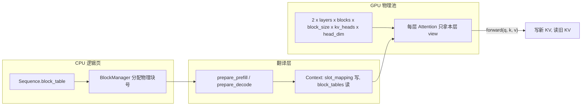

# MinivLLM 阅读顺序

源码对照 [MinivLLM](https://github.com/Wenyueh/MinivLLM) 的 `src/myvllm/`（本地副本 `MinivLLM/`）。本仓库是阅读说明。

这个引擎把 KV cache 拆成三份所有权，模型只负责算当前 token 的 Q、K、V：

- **逻辑页**在 CPU：`Sequence.block_table` 记录一条请求占哪些物理块，`BlockManager` 负责分配和回收。
- **物理池**在 GPU：`ModelRunner` 一次性分配整块张量，每层 `Attention` 只拿到本层的 view。
- **当步地址**在全局 `Context`：`slot_mapping` 告诉这一步新的 K/V 写到哪个槽，`block_tables` 告诉历史 K/V 从哪些块读。

`Attention.forward` 的参数只有 `q, k, v`。cache 不进 forward 签名，每一步由 `prepare_prefill` / `prepare_decode` 写进 `Context`，层里再 `get_context()` 取出来。



官方 [HowToApproachvLLM_zh.md](https://github.com/Wenyueh/MinivLLM/blob/main/HowToApproachvLLM_zh.md) 从激活函数和 LayerNorm 往上搭模型。下面这条线按 KV 的所有权读：先看清「请求、页表、显存池」怎么分开，再进入算子、并行和图化。

## 环境

```bash
curl -LsSf https://astral.sh/uv/install.sh | sh
cd /path/to/MinivLLM
uv sync
uv run pytest tests/test_scheduler.py -v
```

`tests/test_scheduler.py` 不加载权重、不占 GPU，用来确认第 2 步读完之后调度器的行为。

## 1. 契约：`utils/context.py`

全文很短，先读完。`Context` 是进程里的一份全局状态，`set_context` 写入，`reset_context` 清空，`get_context` 给每一层用。

| 字段 | 作用 |
|---|---|
| `is_prefill` | 这一步走整段 attention，还是只读 cache 的 decode |
| `slot_mapping` | 新算出来的 K/V 写入池子的哪个槽 |
| `block_tables` | 历史 K/V 从哪些物理块读 |
| `context_lens` | decode 时每条序列已经有多长 |
| `cu_seqlens_q` / `cu_seqlens_k` | prefill 把多条序列拼成一条之后的累积边界 |
| `max_seqlen_q` / `max_seqlen_k` | 这一批里最长的那段，给 kernel 用 |

模型 `forward(input_ids)` 因此不用加 cache 参数。顺手看 `sampling_parameters.py`，下一步的 `Sequence` 会用到。

读完之后应能说出：prefill 和 decode 各自会填上面哪些字段。

## 2. 逻辑页，先不看 GPU

按这个顺序读 `engine/`：

| 顺序 | 文件 | 看什么 |
|---|---|---|
| 2.1 | `engine/sequence.py` | `token_ids`、`num_cached_tokens`、`block_table`、`num_blocks`、`last_block_num_tokens`、`append_token`、`block()` |
| 2.2 | `engine/block_manager.py` | `can_allocate` / `allocate` / `can_append` / `append` / `deallocate` |
| 2.3 | `engine/scheduler.py` | `schedule()` 先扫 waiting 做 prefill，本步有 prefill 就返回；否则扫 running，每条序列只追加 1 个 token |

`Sequence.__getstate__` 留到第 6 步再看，那是张量并行时少传 token 用的。

`BlockManager` 里的 hash 是 prefix cache 的预留接口。`deallocate` 会清空块上的 `token_ids`，跨序列复用目前走不到，读的时候先把它放在一边。需要看清的是 `can_append`：新 token 已经算进 `num_tokens` 之后，只有 `num_tokens % block_size == 1`（它是新块的第一个 token）才要再申请一块。

读完跑：

```bash
uv run pytest tests/test_scheduler.py -v
```

这一步还没有张量，但已经能回答「这条请求占哪些物理块」。

## 3. 物理池和地址翻译

`layers/attention.py` 里的 Triton kernel 先跳过。先看 `Attention.forward`：它从 `get_context()` 拿 `slot_mapping`，把当前 K/V 写进自己的 `k_cache` / `v_cache`。prefill 用当前 `q, k, v` 做 attention；decode 用 `block_tables` 去池子里读历史 K/V。

然后只读 `engine/model_runner.py` 的三处：

1. `allocate_kv_cache`：分配

   `(2, num_layers, max_cached_blocks, block_size, num_kv_heads, head_dim)`

   再按层挂成 view：`module.k_cache = allocated_kv_cache[0, layer_id]`，`v_cache` 同理。层不知道池子有多大，也不知道块属于谁。

2. `prepare_prefill`：未缓存的 token 拼成一条 `input_ids`。`slot_mapping` 按块展开，最后一块只用 `last_block_num_tokens` 个槽。

3. `prepare_decode`：每条序列只有最后一个 token。写槽是

   `block_table[-1] * block_size + last_block_num_tokens - 1`

   `block_tables` 垫到同一长度，空位填 `-1`。

显存估算、多卡 `all_reduce`、warmup、CUDA graph 这一节先不读。

读完用一个具体例子走一遍：两条序列分到不连续的物理块（例如 block 0 和 block 3）。prefill 按 `slot_mapping` 写入，decode 按 `block_table` 读回。能把这个例子算通，后面的 kernel 和调度都是在换这三份所有权的实现。

## 4. 模型层：forward 里没有 cache

这些文件说明第 3 步的 `Context` 为什么成立。模型只消费 `input_ids`，cache 已经挂在层上。

1. `layers/layernorm.py`、`rotary_embedding.py`、`activation.py`、`sampler.py`、`embedding_head.py`
2. `layers/linear.py` 先看 `ReplicatedLinear`。`ColumnParallelLinear`、`RowParallelLinear`、`QKVColumnParallelLinear` 留到第 6 步。
3. `models/qwen3.py`：`Qwen3Attention.forward(x, positions)` 内部走到 `self.attention(q, k, v)`。MLP、残差、`Qwen3ForCausalLM.forward` 返回 hidden、`compute_logits` 另算 logits，这几处一起看。

`models/llama.py` 是同一套接口的第二遍，qwen3 读通之后再看。

读完核对一件事：`Qwen3DecoderLayer` 的 `forward` 参数里没有 `past_key_values`。

## 5. 把一步推理串起来

`engine/llm_engine.py` 的 `step` 是引擎的心跳：

`schedule` → `prepare_*` 填 `Context` → `model.forward` → `sampler` → `reset_context` → `postprocess`

`postprocess` 把新 token 写进 `Sequence`；这一步把块写满时，由 `BlockManager.append` 收尾。

第一次读把多进程搁下：`world_size = 1`，`step` 直接进 `ModelRunner.run`。`run_model` 只看 `enforce_eager=True` 的直跑路径。`worker_process`、共享内存、`call` / `loop` 留到第 6 步。

读完应能在一次生成里分清两种 step：先若干次 prefill，一次吃掉整段 prompt；之后每步每条序列只处理 1 个 token。入口是仓库根目录的 `main.py`。

## 6. 骨架之后再读

下面这些都坐在第 3 步的分界上，按对分页 KV 的增量来读：

1. `layers/attention.py` 的 `store_kvcache_kernel`，然后 `paged_attention_decode_kernel`。decode 才按 `block_table` 逐块寻址。
2. 同文件的 `flash_attention_varlen_kernel`。prefill 把多条序列拼成一条，靠 `cu_seqlens_q` 切断注意力。
3. 张量并行：`ColumnParallelLinear` 按输出维切，`RowParallelLinear` 按输入维切，只在 Row 的出口做一次 `all_reduce`。这时再看 `Sequence.__getstate__` 和 `llm_engine.py` 里的 worker 进程。
4. `ModelRunner.capture_cudagraph` / `run_model` 的图重放。只包 decode，因为 prefill 的长度不固定。当前仓库这条路径还跑不通：捕获函数读的配置键是 `max_num_seqs`，入口写的是 `max_num_sequences`；`outputs` 按 `vocab_size` 分配，模型返回的是 hidden。
5. `BlockManager` 的 hash 命中。释放块时会清空 `token_ids`，prefill kernel 也不读 `block_tables`，跨序列 prefix cache 还没有接上。

## 各模块各自负责什么

| 模块 | 它知道的事 |
|---|---|
| `Attention` | `q, k, v`、本层 `k_cache` / `v_cache` view、`get_context()` |
| `Sequence` / `BlockManager` | token 和物理块号 |
| `prepare_prefill` / `prepare_decode` | 同时看见 `Sequence` 和 GPU 张量，负责把块号翻译成地址 |
| `Qwen3Model.forward` | `input_ids` 进，hidden 出 |
