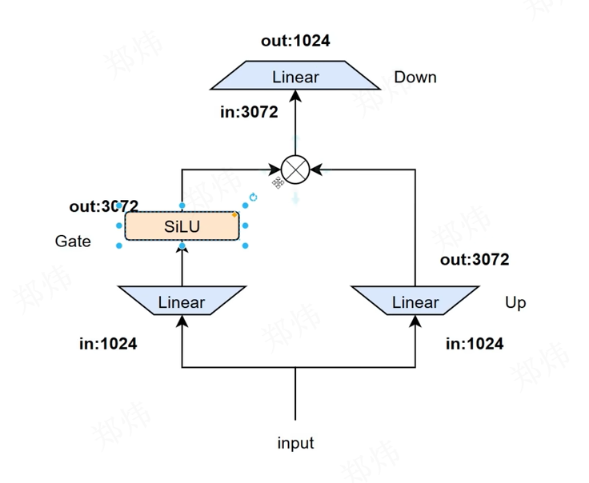
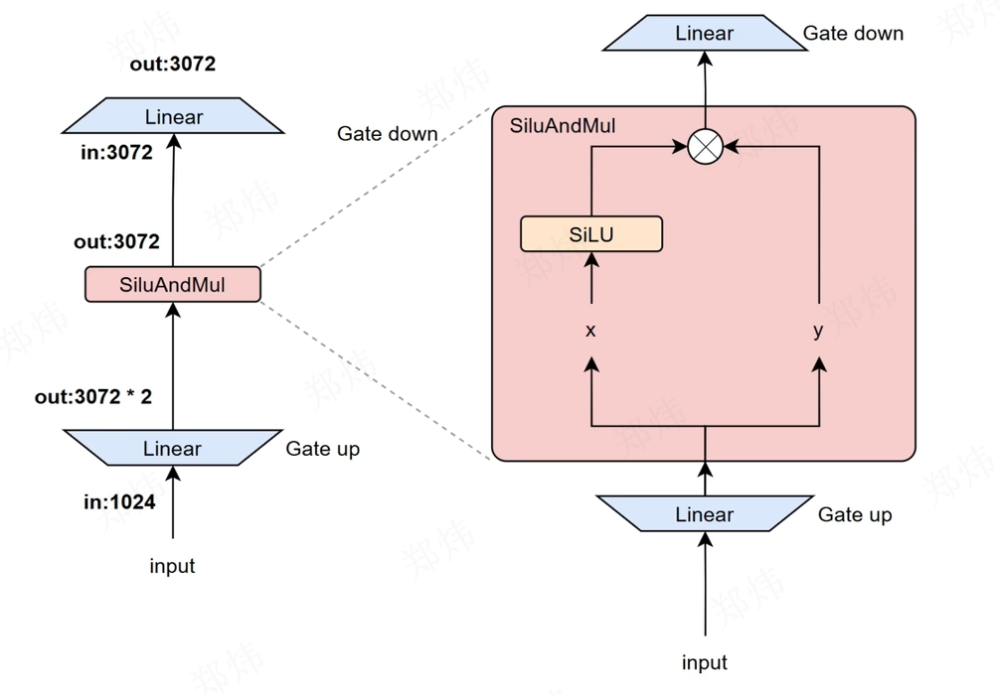
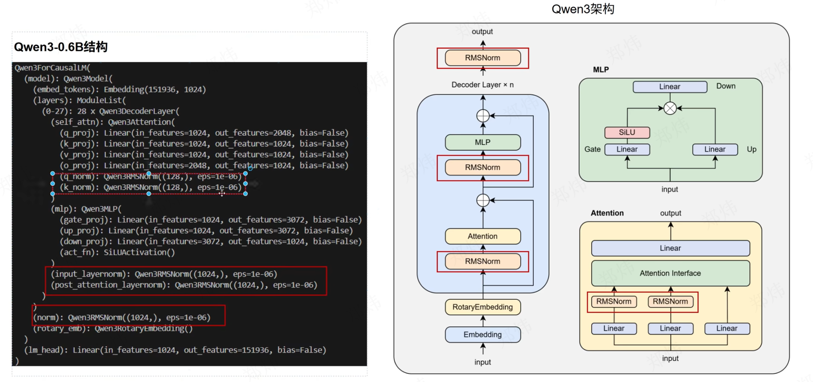
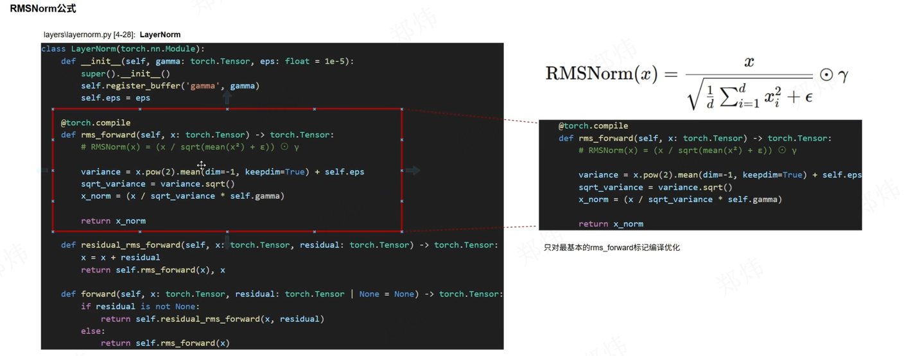

# vllm学习日志
## 1 Layers/activation.py
### 1.1 代码位置
/MinivLLM/src/myvllm/layers/activation.py
### 1.2 SiluAndMul()
将Silu激活(Sigmoid Linear Unit activation)和矩阵乘合并在一起做了算子融合
### 1.3 qwen3 0.6B 模型结构
uv run python check.py
``` md
Qwen3ForCausalLM(
  (model): Qwen3Model(
    (embed_tokens): Embedding(151936, 1024)
    (layers): ModuleList(
      (0-27): 28 x Qwen3DecoderLayer(
        (self_attn): Qwen3Attention(
          (q_proj): Linear(in_features=1024, out_features=2048, bias=False)
          (k_proj): Linear(in_features=1024, out_features=1024, bias=False)
          (v_proj): Linear(in_features=1024, out_features=1024, bias=False)
          (o_proj): Linear(in_features=2048, out_features=1024, bias=False)
          (q_norm): Qwen3RMSNorm((128,), eps=1e-06)
          (k_norm): Qwen3RMSNorm((128,), eps=1e-06)
        )
        (mlp): Qwen3MLP(
          (gate_proj): Linear(in_features=1024, out_features=3072, bias=False)
          (up_proj): Linear(in_features=1024, out_features=3072, bias=False)
          (down_proj): Linear(in_features=3072, out_features=1024, bias=False)
          (act_fn): SiLUActivation()
        )
        (input_layernorm): Qwen3RMSNorm((1024,), eps=1e-06)
        (post_attention_layernorm): Qwen3RMSNorm((1024,), eps=1e-06)
      )
    )
    (norm): Qwen3RMSNorm((1024,), eps=1e-06)
    (rotary_emb): Qwen3RotaryEmbedding()
  )
  (lm_head): Linear(in_features=1024, out_features=151936, bias=False)
)
```
### 1.4 算子融合


## 2 Layers/layernorm.py
/MinivLLM/src/myvllm/layers/layernorm.py
### 2.1 架构


· 伊普西是一个极小值，防止除0
· gemma是一个超参数，用于对某个维度进行缩放
### 2.2 分析
#### 2.2.1 带残差的RMSNorm

第一次进入的时候，没有残差可控连接，所以走没有残差的RMSNorm